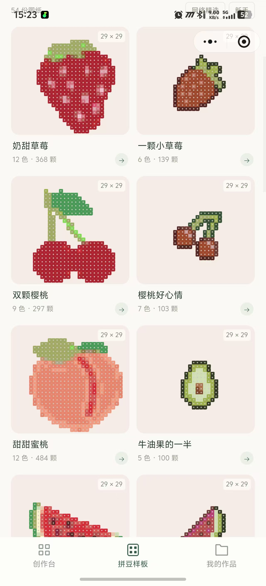
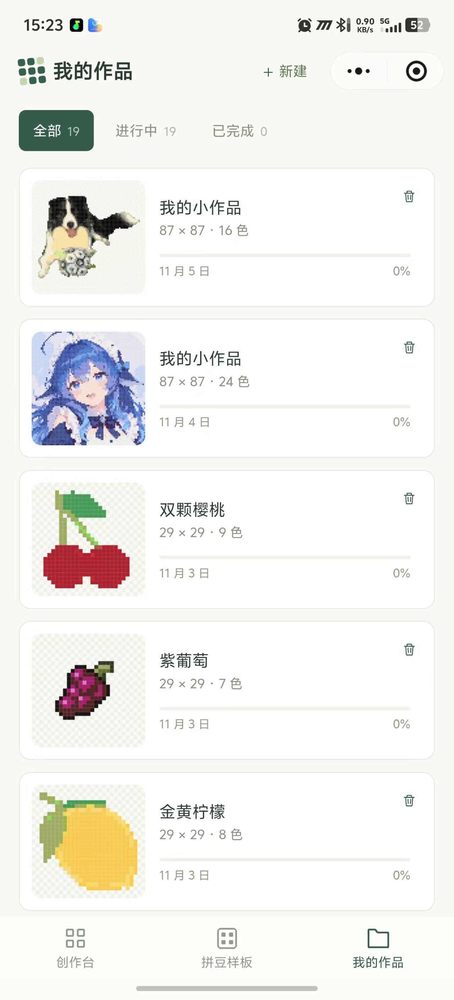
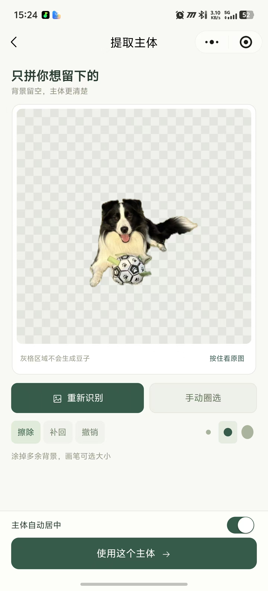
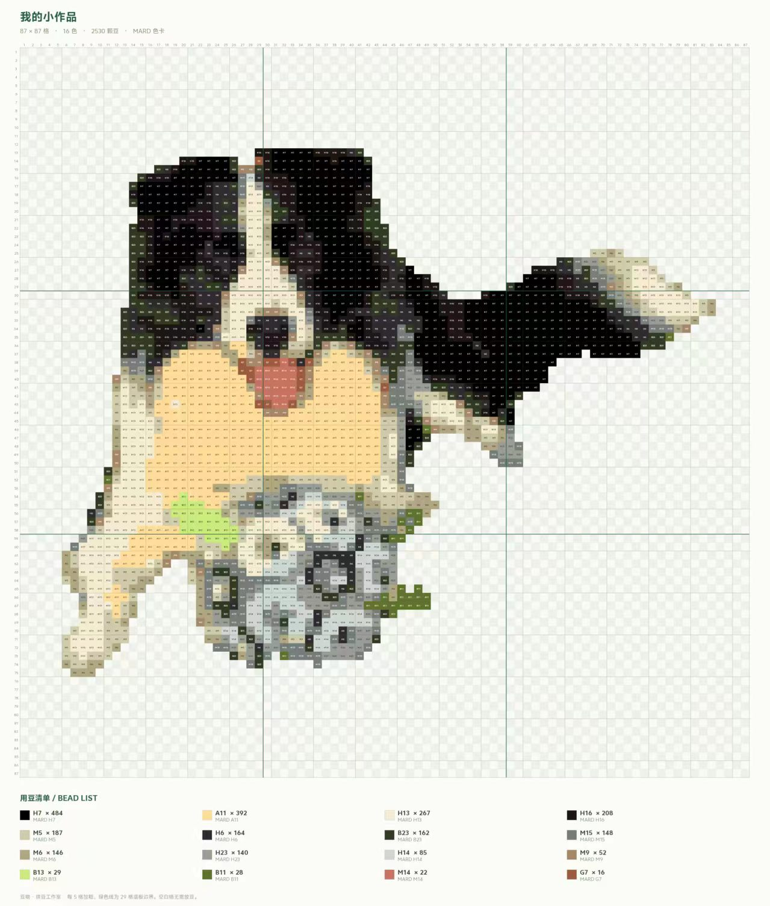
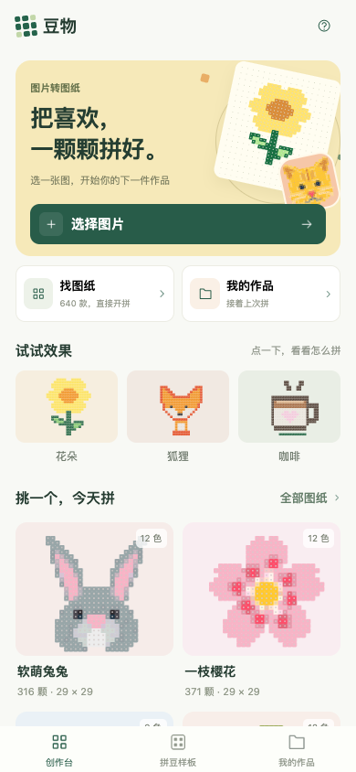
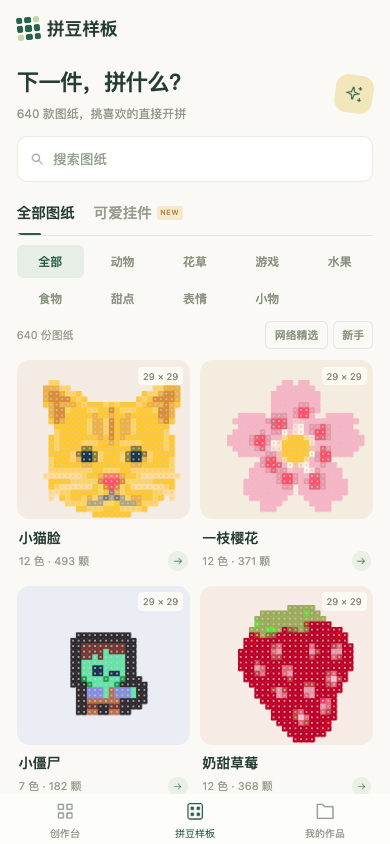
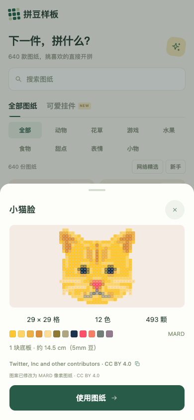
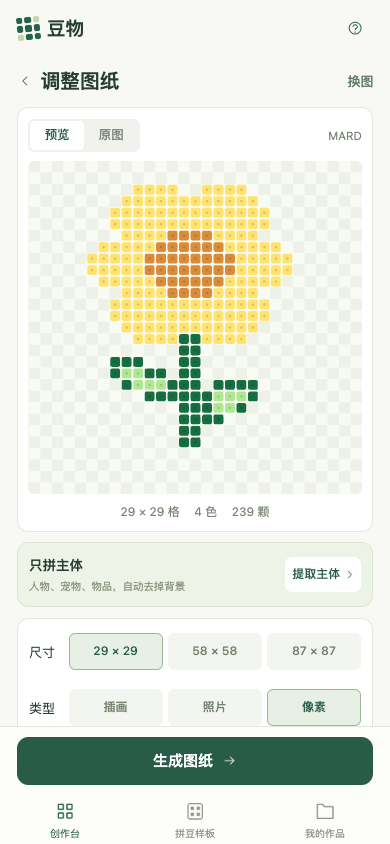
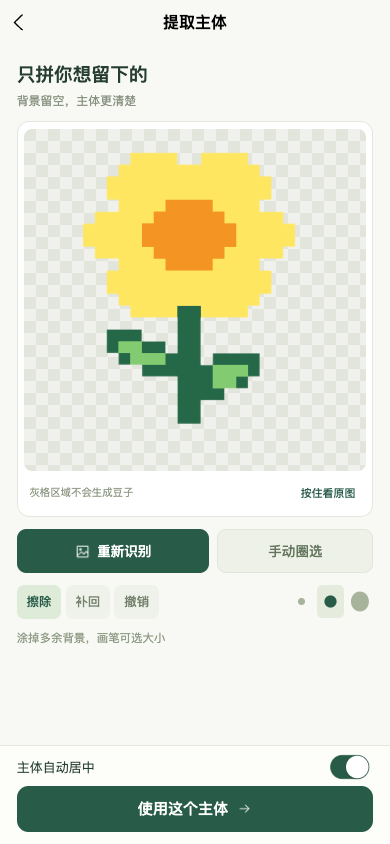
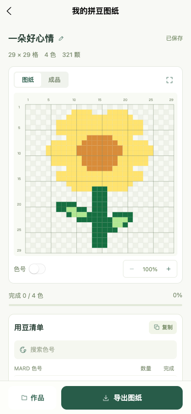

# 豆物 · 拼豆工作室

把喜欢的图片，变成一颗颗可以拼出来的作品。

面向手机的微信小程序，基于 **uni-app + Vue 3**，同时提供 H5 预览。支持图片转图纸、主体提取、640 份离线样板、用豆清单与制作进度。图片转换和主体识别在当前设备执行，无需后端服务或 API 密钥。

## 微信实机展示

以下图片由项目维护者于 2026-11-05 提供，展示微信端样板库、作品库、主体提取和导出图纸。

<table>
  <tr>
    <td align="center"><br>拼豆样板</td>
    <td align="center"><br>我的作品</td>
    <td align="center"><br>提取主体</td>
  </tr>
</table>

<p align="center">
  
  <br>小狗色号图纸 · 87 × 87 格 · 16 色 · 2530 颗
</p>

实机展示仅反映所提供图片中的界面与结果；设备兼容性和测试范围见下方验证说明。

## H5 界面预览

以下为当前源码的 **H5 手机尺寸截图（390 × 844）**，拍摄于 2026-11-05。微信原生导航栏、相册权限和手势表现以真机为准。

<table>
  <tr>
    <td align="center"><br>创作台</td>
    <td align="center"><br>拼豆样板</td>
    <td align="center"><br>样板详情</td>
  </tr>
  <tr>
    <td align="center"><br>调整图纸</td>
    <td align="center"><br>提取主体</td>
    <td align="center"><br>开拼与导出</td>
  </tr>
</table>

[查看全部截图与拍摄说明](docs/screenshots/README.md)

## 功能

| 功能 | 说明 |
| --- | --- |
| 图片转图纸 | 29 / 58 / 87 格；插画、照片、像素三种取样模式；8 / 16 / 24 色或不限色 |
| 色卡匹配 | MARD 221 色、Hama 53 色，使用 CIEDE2000 感知色差匹配与整体限色 |
| 提取主体 | U2Netp 通用主体模型；透明/纯色背景快速提取；圈选、擦除、补回、撤销和居中 |
| 拼豆样板 | 640 份完整逐格图纸，8 个分类；搜索、新手筛选、可爱挂件合集与一键使用 |
| 图纸查看 | 拖动缩放、完整色号、每 5 格加粗、29 格底板分区、成品效果预览 |
| 制作助手 | 颜色高亮、色号搜索、用量复制、逐色完成、制作进度恢复 |
| 图片导出 | 高清 PNG 色号图纸和成品效果，附坐标、用豆清单与适用的素材署名 |
| 我的作品 | 本机保存最近 20 份作品，支持重命名、进度筛选、重新打开与删除 |

## 快速开始

需要 Node.js 20+、npm。微信版本还需要微信开发者工具和有权限使用的 AppID。

```sh
git clone https://github.com/Clientless1/perler-beads.git
cd perler-beads
npm ci
```

### H5 开发预览

```sh
npm run dev:h5
```

打开终端显示的本地地址，使用手机尺寸查看。

### 微信小程序

```sh
npm run build:mp-weixin
```

1. 在微信开发者工具中导入**项目根目录**。`project.config.json` 已将小程序目录设为 `dist/build/mp-weixin/`。
2. 使用自己的账号开发时，同时更新 `src/manifest.json` 中的 `mp-weixin.appid` 和 `project.config.json` 中的 `appid`。
3. 编译后扫码真机预览。主体模型推理要求基础库 **2.30.0+**，微信开发者工具模拟器不支持该原生推理 API。

需要监听微信源码变更时运行 `npm run dev:mp-weixin`，并单独导入 `dist/dev/mp-weixin/`。正式预览和上传请使用 `build:mp-weixin` 的产物。

### 测试与构建

```sh
npm test
npm run build:h5
npm run build:mp-weixin
```

| 命令 | 输出 |
| --- | --- |
| `npm run build:h5` | `dist/build/h5/` |
| `npm run build:mp-weixin` | `dist/build/mp-weixin/` |
| `npm run dev:mp-weixin` | `dist/dev/mp-weixin/` |

## 使用流程

**自己的照片：** 选择图片 → 按需提取主体 → 调整尺寸、类型和颜色 → 生成图纸 → 按色制作 → 导出。

**现成图纸：** 拼豆样板 → 搜索或选择分类 → 查看用量 → 使用图纸 → 开始制作。

照片建议选择主体清楚、背景简单的图片。新手可从 29 格、8 色开始；拼人物或宠物时可尝试 58 格或 87 格。色卡品牌应与手里的豆子一致，屏幕色与实体豆可能有差异。

## 项目结构

```text
src/
├── pages/                  创作台、样板库、图纸结果、作品库
├── subject/                主体提取分包、端侧推理与压缩模型
├── components/             图标、缩略图、用豆清单等组件
├── utils/                  图像取样、配色、画布绘制、存储与任务调度
├── data/                   640 份样板数据及来源记录
├── static/                 图标、示例图和样板封面
├── pages.json              页面、分包和底部导航
└── manifest.json           应用与平台配置
scripts/                    素材导入、样板生成和模型重建脚本
tests/                      核心逻辑与素材完整性测试
docs/                       使用说明、开发说明、验证记录及截图
licenses/                   第三方许可原文
```

## 文档

- [使用说明](docs/USER_GUIDE.md)：从选图、提取主体到导出与进度恢复。
- [开发说明](docs/DEVELOPMENT.md)：运行环境、端侧处理流程、模型资源、样板重建与微信打包。
- [验证记录](docs/VALIDATION.md)：测试结果、构建体积、交互检查和待验证项目。
- [截图说明](docs/screenshots/README.md)：截图环境、页面索引与样板署名。
- [第三方来源与许可](THIRD_PARTY_NOTICES.md)：算法、色卡、模型及图案授权信息。

## 当前验证范围

2026-11-05：**26 项核心测试通过，H5 和微信生产构建通过**。微信主包约 **1.833 MiB**，主体分包约 **1.977 MiB**，分别低于 2 MiB。构建体积会随代码和依赖变化，发布前需重新检查。

H5 已验证示例转图纸、自动主体提取及应用、样板搜索和使用、逐色进度恢复及 PNG 导出。微信新版主体模型的真机推理兼容性、相册权限和低端机性能仍需设备验证，不能以编译成功代替真机通过。复杂毛发、相近背景和多主体图片可能需要手动修整。

作品保存在当前设备，最多保留 20 份。更换设备、清除浏览器或小程序数据前，请先导出需要保留的图纸。

## 素材与致谢

样板包含 **343 份 CC0 图案改编、256 份 Twemoji CC BY 4.0 图案改编和 41 份原创设计**。封面由实际逐格数据生成，来源与许可可在应用内查看；Twemoji 的署名与修改说明会随作品保存及导出。

色彩算法参考 MIT 开源项目 [Perler Beads Generator](https://github.com/Jett-Wu/Perler_Beads_Generator) 和 [Fusible-Beads-Studio](https://github.com/yourlin/Fusible-Beads-Studio)，主体模型使用 Apache 2.0 授权的 [U²-Net](https://github.com/xuebinqin/U-2-Net)。交互参考 [Perlypop](https://perlypop.com/) 与 [Pixel-Beads](https://www.pixel-beads.net/)。完整来源、修改说明及各自适用许可见 [THIRD_PARTY_NOTICES.md](THIRD_PARTY_NOTICES.md)。

## 开源许可

本项目自行编写的代码及原创图案采用 [MIT License](LICENSE)，允许使用、修改和分发，使用时请保留版权与许可声明。

第三方代码、模型、图案及其改编内容分别遵循原有许可，详见 [THIRD_PARTY_NOTICES.md](THIRD_PARTY_NOTICES.md)。维护者提供的微信实机截图、照片及导出展示图仅用于项目展示，不因仓库代码采用 MIT 而自动获得同样授权；图片中的第三方图形仍遵循其原有许可。
