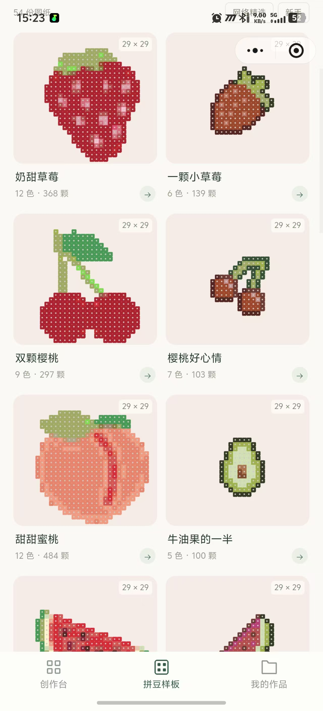
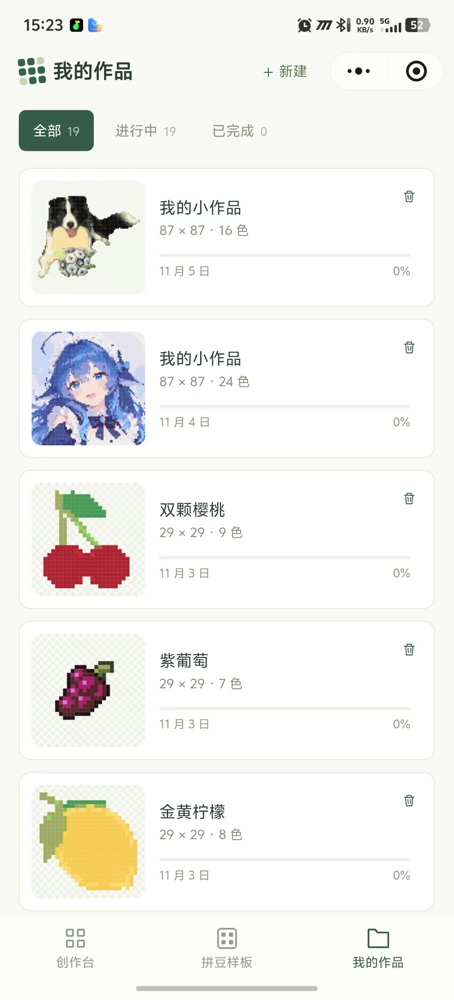
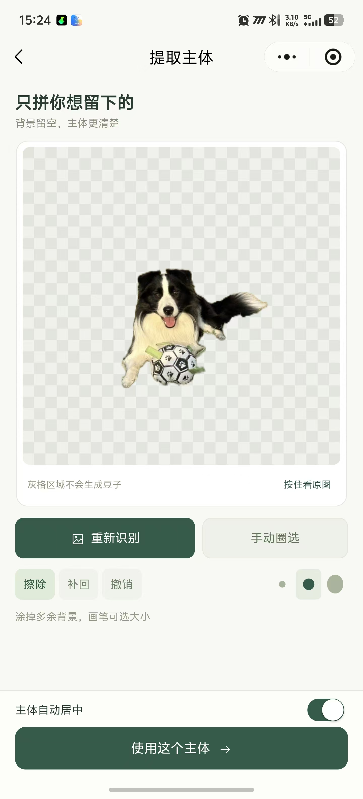
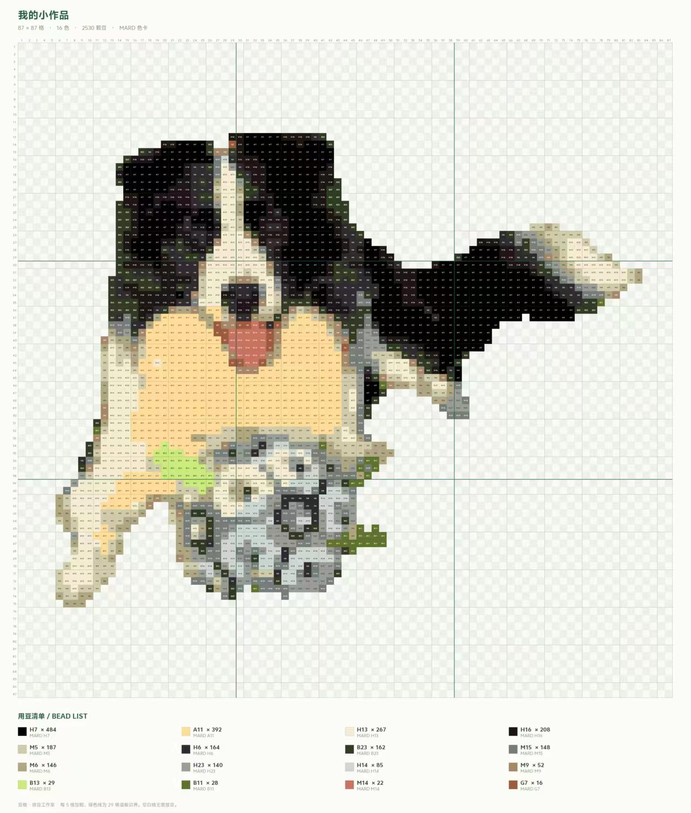
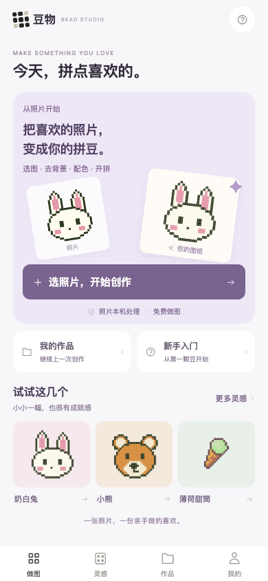
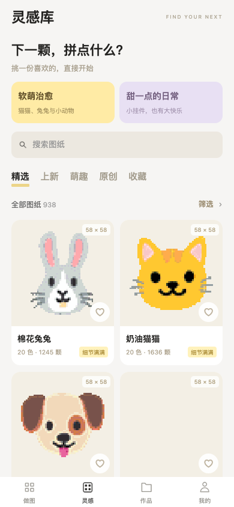
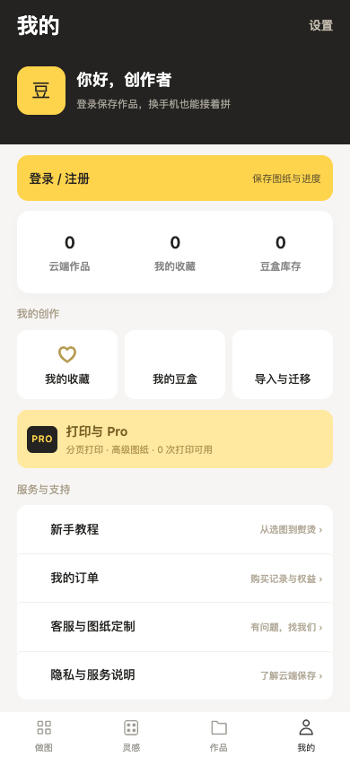
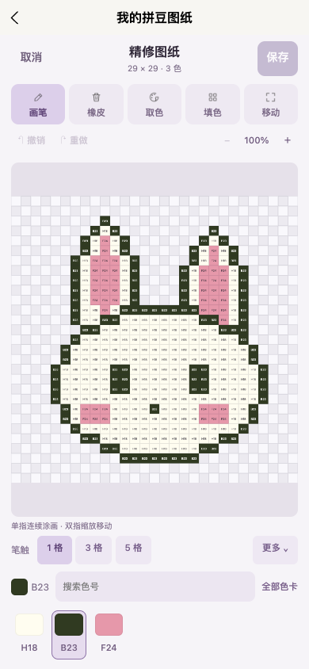
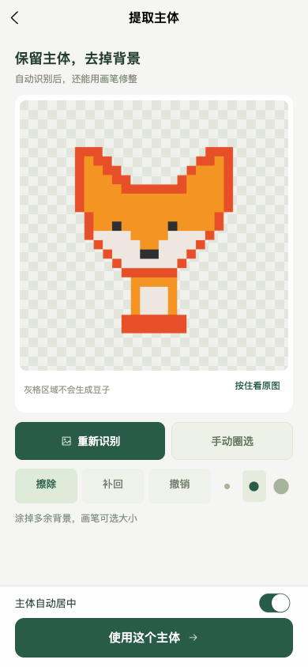
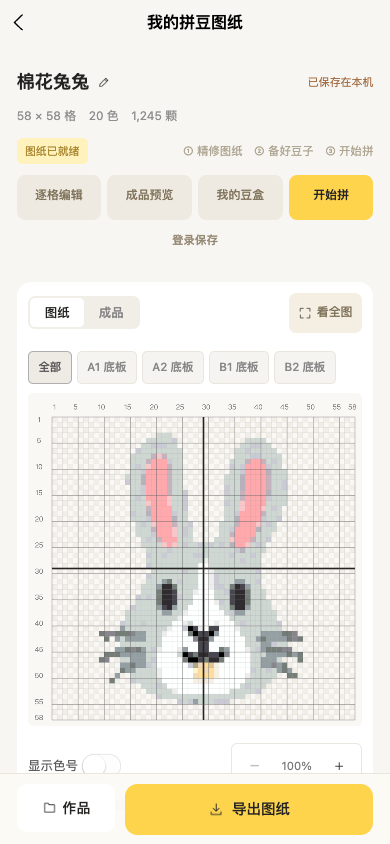

# 豆物 · 拼豆工作室

把喜欢的图片，变成一颗颗可以拼出来的作品。

面向手机的拼豆创作工具，客户端基于 **uni-app + Vue 3**；独立后端基于 **Express + PostgreSQL**，提供 API 和运营管理台。照片转换、主体提取与图片模型检测在设备执行；账号、作品图纸、名称、制作进度、豆盒、订单和客服工单由后端持久化，可跨设备恢复。

**当前版本 2.2.0（2026-11-13 更新）：** 前后端已拆为两个独立项目，服务器仅部署后端和管理台；小程序在本机构建上传。首页更新为暖白/柔紫；三步创作、相册式裁剪、连续逐格编辑、逐色开拼和五种烫法预览已实现，游客可保存本机作品。素材库 938 份。微信正式域名、登录/支付与审核待接入。详见 [本轮更新与部署](docs/DEPLOYED_2_2.md) 和 [开发指南](docs/CLOUD_PLATFORM.md)。

微信实机照片来自维护者提供的旧版；下方手机布局截图为 2.2.0 本地预览，具体验证范围见 [验证记录](docs/VALIDATION.md)。

## 微信实机展示

以下图片由项目维护者于 2026-11-05 提供，展示微信端样板库、作品库、主体提取和导出图纸。

<table>
  <tr>
    <td align="center"><br>拼豆样板</td>
    <td align="center"><br>我的作品</td>
    <td align="center"><br>提取主体</td>
  </tr>
</table>

<p align="center">
  
  <br>小狗色号图纸 · 87 × 87 格 · 16 色 · 2530 颗
</p>

实机展示仅反映所提供图片中的界面与结果；设备兼容性和测试范围见下方验证说明。

## H5 界面预览

以下为本地 H5 的 **手机尺寸截图（390 × 844）**；首页、精修、成品与裁剪更新于 2026-11-13，其余截图保留于 2026-11-12。微信原生导航栏、相册权限和手势表现以真机为准。

<table>
  <tr>
    <td align="center"><br>创作台</td>
    <td align="center"><br>拼豆样板</td>
    <td align="center"><br>我的</td>
  </tr>
  <tr>
    <td align="center"><br>逐格精修</td>
    <td align="center"><br>提取主体</td>
    <td align="center"><br>开拼与导出</td>
  </tr>
</table>

[查看全部截图与拍摄说明](docs/screenshots/README.md)

## 功能

| 功能 | 说明 |
| --- | --- |
| 图片转图纸 | 29 / 58 / 87 格；插画、照片、像素三种取样模式；8 / 16 / 24 色或不限色 |
| 色卡匹配 | MARD 221 色、Hama 53 色，使用 CIEDE2000 感知色差匹配与整体限色 |
| 提取主体 | U2Netp 通用主体模型；透明/纯色背景快速提取；圈选、擦除、补回、撤销和居中 |
| 拼豆样板 | 数据库管理的 938 份完整逐格图纸，8 个分类；搜索、新手筛选、可爱挂件合集与一键使用 |
| 图纸查看 | 拖动缩放、完整色号、每 5 格加粗、29 格底板分区、成品效果预览 |
| 裁剪与精修 | 拖四角裁剪、移动照片、比例与双指缩放；连续画笔、橡皮、取色、填色、1/3/5 格笔触与撤销重做 |
| 多种烫法 | 原豆、轻烫留孔、常规圆烫、平烫封孔、像素方烫；转动、双指缩放、保存视觉模拟图 |
| 制作助手 | 颜色高亮、色号搜索、用量复制、逐色完成、制作进度恢复 |
| 图片导出 | 高清 PNG 色号图纸和成品效果，附坐标、用豆清单与适用的素材署名 |
| 云端作品 | 普通账号 100 份、Pro 2000 份；版本冲突保护、进度恢复、旧作品迁移与工程备份 |
| 像素编辑 | 画笔、橡皮、取色、填色、全图换色、撤销和重做 |
| 我的豆盒 | MARD / Hama 库存、材料成本、缺豆清单与库存配色 |
| 分页打印 | A4 PDF、5mm / 2.6mm 实际比例、黑白色号版、底板分页与校准线 |
| 商业与客服 | 套餐、订单、Pro 和打印次数；咨询/定制工单、员工内部备注 |
| Web 后台 | 客户、图纸、套餐、订单、员工权限、客服处理、审计和真实收入概览 |

## 快速开始

需要 Node.js 22.16+、npm。微信版本还需要微信开发者工具和有权限使用的 AppID。

```sh
git clone https://github.com/Clientless1/perler-beads.git
cd perler-beads
npm ci
```

### 独立后端

本目录仅负责微信小程序与本地手机预览。后端已拆到同级 `../perler-beads-backend/`，包含自己的 `package.json`、锁文件、API、数据库迁移、管理台与部署脚本；无需复制本项目到服务器。

后端运行方式见独立项目 `README.md`。本地联调时先在后端运行 `npm start`，再在本目录运行 `npm run dev:h5`。本地手机网页仅用于开发预览，不部署到服务器。服务器根路径只返回 API 信息，运营管理台位于 `/admin/`。

### 微信小程序

云端业务需要 API。小程序默认连接 `https://1.92.110.111` 供开发调试，开发工具需关闭合法域名校验，手机需开启调试模式，详见 [真机联调](docs/WECHAT_NETWORK.md)。正式构建前在 `.env.local` 设置 `VITE_API_BASE_URL=https://你的备案域名`，并配置微信请求/下载合法域名、实际隐私说明及真实登录/支付凭据。连接本地 API 时需显式设置地址，手机不能通过 `127.0.0.1` 访问电脑。此前官方内容安全接口要求仍未解决，参见 [审核状态](docs/CONTENT_SAFETY.md)。

```sh
npm run build:mp-weixin
```

1. 在微信开发者工具中导入**项目根目录**。`project.config.json` 已将小程序目录设为 `dist/build/mp-weixin/`。
2. 使用自己的账号开发时，同时更新 `src/manifest.json` 中的 `mp-weixin.appid` 和 `project.config.json` 中的 `appid`。
3. 编译后可在模拟器验证照片选图和本地检测：缺少原生推理时使用自带 CPU 实现，检测资源由自带解压器读取。自动提取主体使用微信原生推理，要求基础库 **2.30.0+** 和压缩文件读取支持，需扫码真机验证；模拟器可手动圈选主体。

需要监听微信源码变更时运行 `npm run dev:mp-weixin`，并单独导入 `dist/dev/mp-weixin/`。正式预览和上传请使用 `build:mp-weixin` 的产物。

### 测试与构建

```sh
npm test
npm run build:h5
npm run build:mp-weixin
npm run check:release
```

| 命令 | 输出 |
| --- | --- |
| `npm run build:h5` | `dist/build/h5/` |
| `npm run build:mp-weixin` | `dist/build/mp-weixin/` |
| `npm run dev:mp-weixin` | `dist/dev/mp-weixin/` |

## 使用流程

**自己的照片：** 选择图片 → 按需提取主体 → 调整尺寸、类型和颜色 → 生成图纸 → 按色制作 → 导出。

**现成图纸：** 拼豆样板 → 搜索或选择分类 → 查看用量 → 使用图纸 → 开始制作。

照片建议选择主体清楚、背景简单的图片。新手可从 29 格、8 色开始；拼人物或宠物时可尝试 58 格或 87 格。色卡品牌应与手里的豆子一致，屏幕色与实体豆可能有差异。

## 项目结构

客户端：`perler-beads-main/`。独立后端：同级 `perler-beads-backend/`。两者分别安装依赖、测试和发布。

客户端仓库：[Clientless1/perler-beads](https://github.com/Clientless1/perler-beads)。独立后端仓库：[Clientless1/perler-beads-backend](https://github.com/Clientless1/perler-beads-backend)，目前为私有仓库，需要访问授权。后端不进入小程序或 App 构建包。

```text
src/
├── pages/                  创作台、样板库、图纸结果、作品库
├── subject/                主体提取分包、端侧推理与压缩模型
├── components/             图标、缩略图、用豆清单等组件
├── utils/                  图像取样、配色、画布绘制、存储与任务调度
├── data/                   640 份样板数据及来源记录
├── static/                 图标、示例图和样板封面
├── pages.json              页面、分包和底部导航
└── manifest.json           应用与平台配置
scripts/                    素材导入、样板生成和模型重建脚本
tests/                      核心逻辑与素材完整性测试
docs/                       使用说明、开发说明、验证记录及截图
licenses/                   第三方许可原文
```

## 文档

- [手机号验证码登录](docs/PHONE_LOGIN.md)：阿里云短信选型、旧账号绑定、后端配置与真实收码验收。
- [云平台运行与迁移](docs/CLOUD_PLATFORM.md)：本地账号、配置、服务器部署、备份恢复与当前边界。
- [使用说明](docs/USER_GUIDE.md)：从选图、提取主体到导出与进度恢复。
- [开发说明](docs/DEVELOPMENT.md)：运行环境、端侧处理流程、模型资源、样板重建与微信打包。
- [验证记录](docs/VALIDATION.md)：测试结果、构建体积、交互检查和待验证项目。
- [本地处理与审核复核](docs/CONTENT_SAFETY.md)：数据流、隐私边界、复核文案和提交前检查。
- [微信提审核对](docs/WECHAT_REVIEW.md)：最新代码检查结果、提交表单填写和待复核事项。
- [截图说明](docs/screenshots/README.md)：截图环境、页面索引与样板署名。
- [第三方来源与许可](THIRD_PARTY_NOTICES.md)：算法、色卡、模型及图案授权信息。

## 当前验证范围

客户端逻辑与页面流程测试、独立 PostgreSQL schema 后端集成测试覆盖作品归属、并发版本、幂等迁移、订单与权益、PDF 和员工权限。最新执行结果见 [验证记录](docs/VALIDATION.md)。H5 交互联调与 PDF 渲染均使用真实本地 API 和数据库；微信真机、真实微信登录/付款、退款、域名备案与平台审核仍需实际接入验证。

当前为本地可运行的首版云平台。线上仅运行构建后的静态页面和 API；开发服务器不得暴露公网。uni-app 构建链仍有上游依赖审计告警，详见迁移指南，不代表全项目无漏洞。照片检测可能误判或漏判，不能以构建成功代替审核通过。

## 素材与致谢

样板包含 **343 份 CC0 图案改编、256 份 Twemoji CC BY 4.0 图案改编和 41 份原创设计**。封面由实际逐格数据生成，来源与许可可在应用内查看；Twemoji 的署名与修改说明会随作品保存及导出。

色彩算法参考 MIT 开源项目 [Perler Beads Generator](https://github.com/Jett-Wu/Perler_Beads_Generator) 和 [Fusible-Beads-Studio](https://github.com/yourlin/Fusible-Beads-Studio)，主体模型使用 Apache 2.0 授权的 [U²-Net](https://github.com/xuebinqin/U-2-Net)。交互参考 [Perlypop](https://perlypop.com/) 与 [Pixel-Beads](https://www.pixel-beads.net/)。完整来源、修改说明及各自适用许可见 [THIRD_PARTY_NOTICES.md](THIRD_PARTY_NOTICES.md)。

## 开源许可

本项目自行编写的代码及原创图案采用 [MIT License](LICENSE)，允许使用、修改和分发，使用时请保留版权与许可声明。

第三方代码、模型、图案及其改编内容分别遵循原有许可，详见 [THIRD_PARTY_NOTICES.md](THIRD_PARTY_NOTICES.md)。维护者提供的微信实机截图、照片及导出展示图仅用于项目展示，不因仓库代码采用 MIT 而自动获得同样授权；图片中的第三方图形仍遵循其原有许可。
